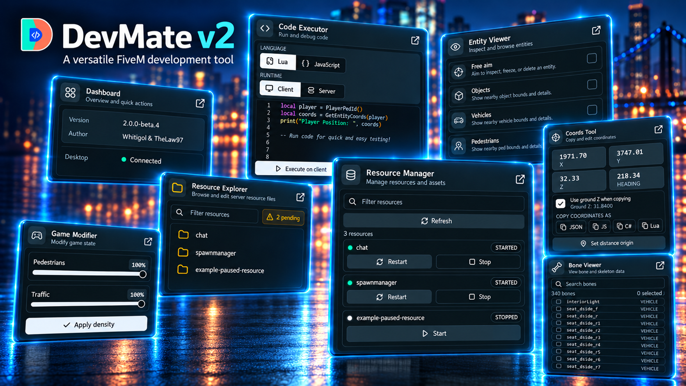

## DevMate v2 is here

DevMate v2 is a complete rebuild of the FiveM development toolkit. The new release brings the tools you use in game into a clearer interface, adds a Windows Desktop companion, and strengthens permission checks around sensitive actions.

Explore the new [DevMate v2 documentation](/docs/fivem-scripts/devmate) to install it or upgrade an existing server.

## A new interface, in game and on Desktop

The redesigned in-game menu keeps each tool focused and makes permission requirements visible. DevMate Desktop mirrors the tools authorized for your current player in a full Windows workspace and connects automatically on the same computer—no pairing step required.

Desktop also adds live FiveM client logs with search, level filters, copying, log-file access, and client console commands.

## New development tools

- **Event Watcher** subscribes to client or server events and displays captured payloads as they happen.
- **Resource Explorer** browses and edits server resource files through explicit, generated filesystem permissions.
- **Bone Viewer** searches vehicle and pedestrian bones and displays selected bones in game.
- **Coords Tool** now copies JSON, JavaScript, C#, or Lua coordinates, supports ground Z, and measures distance from a saved origin.

The Entity Viewer, Resource Manager, Code Executor, OneSync Blip, and Game Modifier have all been brought into the new shared interface.

## Safer server workflows

- Server permissions are enforced for every tool, including actions sent from Desktop.
- Unauthorized modules stay visible and explain that access is required.
- Resource stops and restarts require confirmation and use the configured Safe Restart delay.
- Resource Explorer rejects unsafe paths and binary or oversized files.
- Pending actions report timeouts and connection failures instead of waiting indefinitely.

## Easier updates

DevMate can now download and verify resource updates during server startup while preserving protected configuration and permission files. Existing supported configurations migrate to the v2 format automatically.

DevMate Desktop also updates itself. The resource resolves the latest published Windows installer dynamically, so the Dashboard download always points to the current release.

## Version compatibility

DevMate resource v2.0.0 and DevMate Desktop v1.0.0 establish the stable Desktop bridge. Their version numbers are intentionally independent, and either product can be upgraded first while baseline tools remain compatible.
