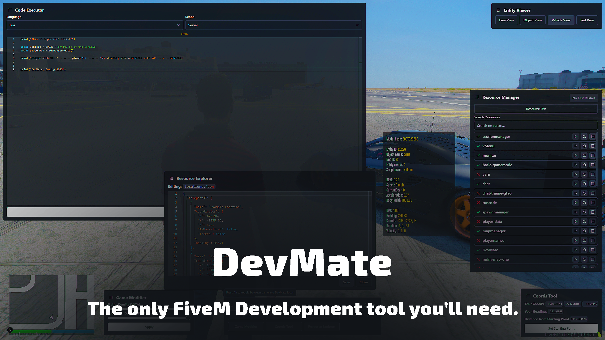

## 🚀 DevMate v1.0.0 Release

We’re thrilled to announce the launch of **DevMate v1.0.0**, a major milestone in FiveM development tooling. This marks the beginning of a new chapter, and we’re excited to share it with you.

Explore our [documentation](/docs/fivem-scripts/devmate) to learn more about the features and get started.

---

## 🔧 What’s Next?

The journey is just beginning. While some plans are still under wraps, here’s a sneak peek at what’s coming:

### 🏎️ Vehicle Editor

- **Real-Time Handling and Physics Adjustments** 
  Fine-tune vehicle performance with precision.
- **Engine Audio Customization** 
  Modify engine sounds and update metadata seamlessly.

### 📍 Entity Tracking

- **Blip Tracking in the Entity Viewer** 
  Mark any entity in the game world and track its position in real time.

### ⚙️ Internal Enhancements

- **Transition to a New FiveM Compiler** 
  Upgrading our tooling for faster development and smoother workflows.

---

There’s plenty more to come, and we’re excited to share future updates with you. Thanks for being part of the journey!
